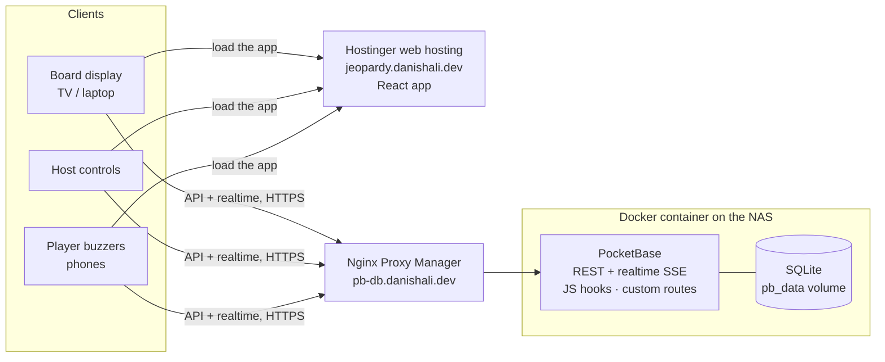

# Buzzwire

A real-time, buzz-in quiz party game for friends and family. The host puts the board on a TV,
everyone joins from their phone with a 4-letter room code, and the fastest finger wins the clue.

> **Status:** milestone 1 of 8 (scaffold, PocketBase, Docker). The landing page and server
> wiring work. The game screens are placeholders until later milestones.

## How it fits together



Two services:

- **Frontend** on Hostinger web hosting at `jeopardy.danishali.dev`. A static React build. Its
  `.htaccess` sends every unknown path to `index.html`, so routes like `/room/ABCD/board` work on
  refresh. On each push to `main`, CI builds it against the production API and publishes the
  files to the `frontend-dist` branch, which Hostinger deploys.
- **PocketBase** on the Synology NAS at `pb-db.danishali.dev`, behind Nginx Proxy Manager. It
  holds the database, auth, the realtime stream, and the custom game routes in `pb_hooks/`. CI
  publishes its Docker image to GHCR.

The Docker image also bundles the built app in `pb_public/`, so PocketBase can serve everything
from one origin too (that's how `make up` and the smoke test run). The full deployment runbook is
in [docs/DEPLOY.md](docs/DEPLOY.md).

## Tech stack

| Layer    | Choice                                                                  |
| -------- | ----------------------------------------------------------------------- |
| Frontend | React 19, Vite 8, TypeScript (strict), React Router                     |
| Styling  | Tailwind CSS v4, shadcn/ui                                              |
| Backend  | PocketBase 0.40 (SQLite, auth, realtime, JS hooks)                      |
| Testing  | Vitest (Playwright and integration tests to come)                       |
| Hosting  | Hostinger web hosting (frontend), Docker on a Synology NAS (PocketBase) |

## Repository layout

```
web/             React app (Vite root)
  src/pages/     Screens
  src/lib/       PocketBase client, helpers
pb_hooks/        Server-side game logic: custom routes, cron jobs (*.pb.js)
pb_migrations/   Schema and settings migrations, applied automatically on start
tests/unit/      Vitest unit tests
tests/smoke.sh   Container smoke test
docker/          Dockerfile
docs/            DECISIONS.md
```

## Local development

Requirements: Node 22+, `make`, `curl` and `unzip`. Docker is only needed for image builds.

```sh
make install   # npm ci + download the pinned PocketBase binary into .pb/
make dev       # PocketBase on :8090 and Vite on :5173
```

Open http://localhost:5173. Vite proxies `/api` and `/_/` to PocketBase, so the app talks to the
API on its own origin, exactly as in production. There's no API URL to configure.

The first time PocketBase starts it prints a link to create your superuser (admin) account. Open
it, or run:

```sh
.pb/pocketbase superuser upsert you@example.com 'a-long-password' --dir pb_data
```

Your local database lives in `pb_data/` (git-ignored). PocketBase also writes
`pb_data/types.d.ts` there, which gives editors autocompletion in `pb_hooks` and `pb_migrations`.

Other commands (`make help` lists them all):

| Command      | What it does                                         |
| ------------ | ---------------------------------------------------- |
| `make check` | Typecheck, lint, Prettier check and unit tests       |
| `make build` | Build the React app into `dist/`                     |
| `make image` | Build the Docker image                               |
| `make smoke` | Build the image, start it, and check it responds     |
| `make push`  | Build for `linux/amd64` and push to the registry     |
| `make up`    | Run the production stack locally with docker compose |

## Deployment

[docs/DEPLOY.md](docs/DEPLOY.md) has the full steps, written so agents with access to Hostinger and
the NAS can follow them. In short:

- **CI** (`.github/workflows/ci.yml`) checks every push and PR. On `main` it publishes
  `ghcr.io/danish12196/buzzwire` (PocketBase, `:latest` and `:<commit sha>`) and the built
  frontend to the `frontend-dist` branch.
- **Frontend:** Hostinger's Git deployment pulls `frontend-dist` into `jeopardy.danishali.dev`.
- **PocketBase:** `docker-compose.yml` on the NAS, with data in the `pb_data` volume. To update:
  `docker compose pull && docker compose up -d`.
- **Nginx Proxy Manager** forwards `pb-db.danishali.dev` to the container. It has to let realtime
  events (server-sent events) through unbuffered: see the config in DEPLOY.md.
- **Backups:** PocketBase backs up nightly at 03:00 UTC, keeping 7, inside the `pb_data` volume.
- The superuser is created on the NAS at first run. No credentials are stored in the repo.

## Roadmap

1. ✅ Scaffold React + PocketBase, Dockerfile, container behind the proxy
2. Collections, migrations, API rules, demo board
3. Host auth, board editor, CSV import
4. Player join, rooms, lobby, presence
5. Server-side state machine, host controls, board display
6. Buzz route, transaction-based fairness, lockouts, scoring
7. Results, polish, rate limiting, cleanup cron
8. End-to-end tests, GIF, final deploy

Design decisions are recorded in [docs/DECISIONS.md](docs/DECISIONS.md).
