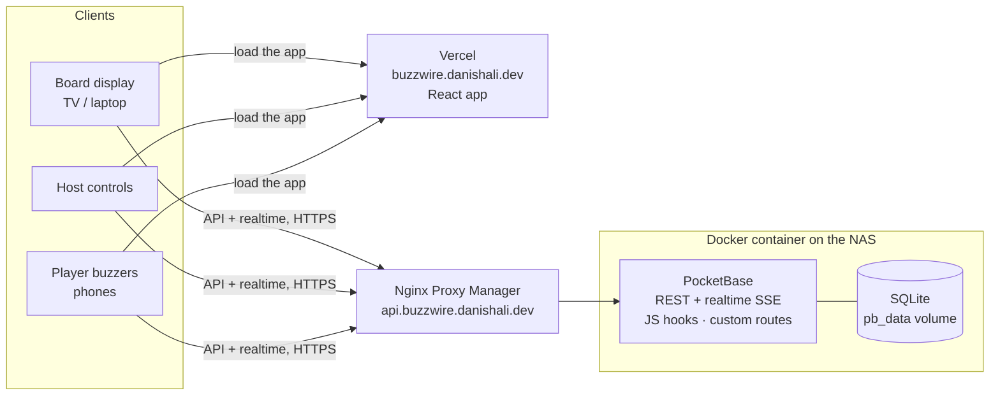

# Buzzwire

A real-time, buzz-in quiz party game for friends and family. The host puts the board on a TV,
everyone joins from their phone with a 4-letter room code, and the fastest finger wins the clue.

> **Status:** milestone 1 of 8 (scaffold, PocketBase, Docker). The landing page and server
> wiring work. The game screens are placeholders until later milestones.

## How it fits together



Two services:

- **Frontend** on Vercel at `buzzwire.danishali.dev`. A static React build; Vercel rewrites every
  path to `index.html` so routes like `/room/ABCD/board` work on refresh. `VITE_PB_URL` tells it
  where the API is.
- **PocketBase** on the Synology NAS at `api.buzzwire.danishali.dev`, behind Nginx Proxy Manager.
  It holds the database, auth, the realtime stream, and the custom game routes in `pb_hooks/`.

The Docker image also bundles the built app in `pb_public/`, so PocketBase can serve everything
from one origin too (that's how `make up` and the smoke test run). The step-by-step deployment,
including prompts you can hand to an agent, is in [docs/DEPLOY.md](docs/DEPLOY.md).

## Tech stack

| Layer    | Choice                                                   |
| -------- | -------------------------------------------------------- |
| Frontend | React 19, Vite 8, TypeScript (strict), React Router      |
| Styling  | Tailwind CSS v4, shadcn/ui                               |
| Backend  | PocketBase 0.40 (SQLite, auth, realtime, JS hooks)       |
| Testing  | Vitest (Playwright and integration tests to come)        |
| Hosting  | Vercel (frontend), Docker on a Synology NAS (PocketBase) |

## Repository layout

```
web/             React app (Vite root)
  src/pages/     Screens
  src/lib/       PocketBase client, helpers
pb_hooks/        Server-side game logic: custom routes, cron jobs (*.pb.js)
pb_migrations/   Schema and settings migrations, applied automatically on start
tests/unit/      Vitest unit tests
tests/smoke.sh   Container smoke test
docker/          Dockerfile
docs/            DECISIONS.md
```

## Local development

Requirements: Node 22+, `make`, `curl` and `unzip`. Docker is only needed for image builds.

```sh
make install   # npm ci + download the pinned PocketBase binary into .pb/
make dev       # PocketBase on :8090 and Vite on :5173
```

Open http://localhost:5173. Vite proxies `/api` and `/_/` to PocketBase, so the app talks to the
API on its own origin, exactly as in production. There's no API URL to configure.

The first time PocketBase starts it prints a link to create your superuser (admin) account. Open
it, or run:

```sh
.pb/pocketbase superuser upsert you@example.com 'a-long-password' --dir pb_data
```

Your local database lives in `pb_data/` (git-ignored). PocketBase also writes
`pb_data/types.d.ts` there, which gives editors autocompletion in `pb_hooks` and `pb_migrations`.

Other commands (`make help` lists them all):

| Command      | What it does                                         |
| ------------ | ---------------------------------------------------- |
| `make check` | Typecheck, lint, Prettier check and unit tests       |
| `make build` | Build the React app into `dist/`                     |
| `make image` | Build the Docker image                               |
| `make smoke` | Build the image, start it, and check it responds     |
| `make push`  | Build for `linux/amd64` and push to the registry     |
| `make up`    | Run the production stack locally with docker compose |

## Self-hosting

These steps are for a Synology NAS with Container Manager and Nginx Proxy Manager (NPM), but any
Docker host works.

### 1. The image

Every push to `main` runs CI (`.github/workflows/ci.yml`). Once the checks pass, it builds the
image for `linux/amd64` (the DS923+ is x86_64) and pushes it to
`ghcr.io/danish12196/buzzwire:latest`, plus a `:<commit sha>` tag for rollbacks.

GHCR packages start private. Either make the package public (GitHub → Packages → buzzwire →
Package settings → Change visibility), or run `docker login ghcr.io` on the NAS with a token that
has `read:packages`.

To build and push by hand instead: copy `.env.example` to `.env`, `docker login ghcr.io`, then
`make push`.

### 2. Run it on the NAS

In Container Manager, create a **Project** (for example in `/volume1/docker/buzzwire`) using
`docker-compose.yml` from this repo and a `.env` based on `.env.example`. Or, over SSH:

```sh
docker compose pull && docker compose up -d
```

The database, uploaded files and backups live in the `pb_data` named volume, so they survive image
updates. To update after a push to `main`: `docker compose pull && docker compose up -d` on the
NAS.

### 3. Create the superuser

On first start, the container log shows an install link
(`http://0.0.0.0:8090/_/#/pbinstall/...`). Open the same path on your domain, or run:

```sh
docker compose exec buzzwire /pb/pocketbase superuser upsert you@example.com 'a-long-password' --dir /pb/pb_data
```

No credentials are stored in the repo or the image.

### 4. Nginx Proxy Manager

Add a **Proxy Host**:

- **Domain:** `api.buzzwire.danishali.dev`
- **Forward to:** `http://<NAS LAN IP>:8090` (the `BUZZWIRE_PORT` from `.env`)
- **Block common exploits:** on. **Websockets support:** not needed (realtime uses SSE).
- **SSL:** request a Let's Encrypt certificate, then turn on Force SSL and HTTP/2.

In the **Advanced** tab, paste the following. Realtime updates use server-sent events, which
break if nginx buffers the response or closes long-lived connections:

```nginx
# Realtime (SSE): stream events immediately and keep idle connections open.
proxy_buffering off;
proxy_cache off;
proxy_read_timeout 1h;
proxy_send_timeout 1h;

# Only allow the PocketBase admin dashboard from the home network.
location /_/ {
    allow 192.168.0.0/16;   # adjust to your LAN
    deny all;
    include conf.d/include/proxy.conf;
}
```

PocketBase is configured (by a migration) to trust the `X-Real-IP` header NPM sends, so logs and
rate limits see real client IPs. For that reason, don't expose port 8090 to the internet directly:
only NPM should reach it.

The dashboard block hides the admin UI, but not the superuser API behind it. For a stricter lock,
add your LAN range to PocketBase's _Superuser IPs_ setting in the dashboard settings. Do this
from a LAN address, or you'll lock yourself out.

### Backups

A migration turns on PocketBase's scheduled backups: every night at 03:00 UTC, keeping the last 7,
stored in `pb_data/backups` inside the volume. You can change the schedule, trigger a backup or
restore one under _Settings → Backups_. To keep copies off the NAS, configure S3 storage there, or
include the Docker volume in Hyper Backup.

### Health check

The image's Docker `HEALTHCHECK` calls PocketBase's built-in `GET /api/health`. Container Manager
shows the status, and `tests/smoke.sh` waits for it.

### Frontend on Vercel

Import the repo into Vercel as a project named `buzzwire`. `vercel.json` sets the build. Add one
environment variable, `VITE_PB_URL=https://api.buzzwire.danishali.dev`, and the domain
`buzzwire.danishali.dev`. Vercel then deploys every push to `main`.

PocketBase allows cross-origin requests from any origin by default. That's safe here: auth uses
tokens in request headers, not cookies, so other sites can't act as a signed-in user.

## Roadmap

1. ✅ Scaffold React + PocketBase, Dockerfile, container behind the proxy
2. Collections, migrations, API rules, demo board
3. Host auth, board editor, CSV import
4. Player join, rooms, lobby, presence
5. Server-side state machine, host controls, board display
6. Buzz route, transaction-based fairness, lockouts, scoring
7. Results, polish, rate limiting, cleanup cron
8. End-to-end tests, GIF, final deploy

Design decisions are recorded in [docs/DECISIONS.md](docs/DECISIONS.md).
